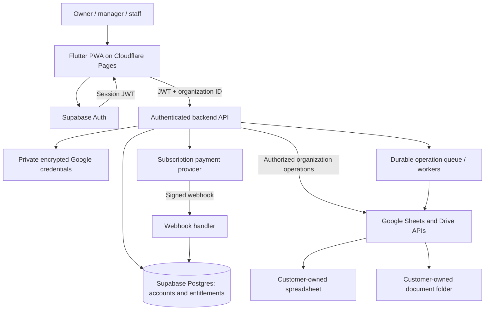

# Bed Space Management SaaS Architecture

Status: target architecture with an initial owner-only implementation. The app
now includes a landing page, Supabase email accounts and profiles, owner-scoped
storage bindings, and customer-owned Google spreadsheet/folder setup. The
organization and backend Google API layers below remain planned. Owner-level
trial entitlements and Paymob test-ready renewal checkout/webhooks are now
implemented; merchant keys and deployment are documented in `docs/PAYMOB_SETUP.md`. The
existing accommodation application still uses direct Google API access.

## 1. Product model

A registered customer creates an organization, subscribes to the SaaS, and
connects their own Google account. Supabase manages SaaS identities, access and
subscriptions. Each organization's accommodation records and documents remain
in its own Google Sheets and Drive.

An organization is the customer boundary. One user may belong to multiple
organizations; each request must explicitly select one. A Google account is a
storage connection, not the organization's identity.

Initial scope: one connected Google account, one active management spreadsheet
and one document folder per organization. Multiple buildings and subrooms live
inside that spreadsheet. Multiple spreadsheets can be added later.

## 2. Components and trust boundaries



- **Flutter PWA / Cloudflare Pages:** UI, local cache, offline drafts, PDF preview/download,
  WhatsApp message preparation and authenticated API calls.
- **Supabase Auth:** user registration, login, session renewal and logout.
- **Supabase Postgres:** organizations, memberships, plans, subscriptions,
  storage references and minimal operation metadata.
- **Backend API:** Supabase Edge Functions for bounded requests, Google OAuth
  callbacks and payment webhooks. Use a dedicated worker if jobs exceed the
  selected runtime's execution limits.
- **Google Sheets:** authoritative accommodation records.
- **Google Drive:** customer-owned PDFs and uploaded documents.
- **Payment provider:** hosted subscription checkout, payment methods and
  subscription management. Select the provider after confirming business
  country, currency and recurring-payment support.

The browser must not receive Google refresh tokens, provider secret keys,
Supabase service-role keys or token-encryption keys.

## 3. Data ownership

| Data | Authoritative location | Notes |
|---|---|---|
| Login identities and sessions | Supabase Auth | Supabase user ID identifies an individual |
| Customer organization and billing contact | Supabase Postgres | SaaS account information |
| Membership and roles | Supabase Postgres | Organization-scoped access |
| Plans, subscription and access entitlement | Supabase Postgres | Updated by verified provider events |
| Google connection and file IDs | Supabase Postgres | Metadata only |
| Google refresh token | Private encrypted backend storage | No browser SELECT access |
| Buildings, rooms, subrooms, beds | Customer spreadsheet | Stable IDs, never row numbers as identity |
| Tenants, payments and expenses | Customer spreadsheet | Includes personally identifiable information |
| Rent invoice and receipt records | Customer spreadsheet | Immutable issued-document snapshots |
| Invoice PDFs, receipt PDFs and attachments | Customer Drive folder | Restricted sharing by default |
| SaaS subscription invoices | Payment provider | Separate from customer rent invoices |
| Pending edits and cached records | Namespaced browser database | Temporary copies, not the source of truth |

Do not replicate full tenant records into Supabase for analytics by default.
Technical queues may temporarily hold encrypted operation payloads where
necessary; apply a documented retention period and purge completed payloads.
Logs and error reports must redact names, phone numbers, tokens and file content.

## 4. Supabase schema

All organization-owned records use an `organization_id` foreign key. Use UUIDs
for identifiers and UTC timestamps for persisted event times.

| Table | Main fields |
|---|---|
| `profiles` | `user_id`, `display_name`, `created_at` |
| `organizations` | `id`, `name`, `owner_user_id`, `timezone`, `currency`, `created_at` |
| `organization_members` | `organization_id`, `user_id`, `role`, `status` |
| `organization_invitations` | `id`, `organization_id`, `email`, `role`, `token_hash`, `expires_at`, `accepted_at` |
| `plans` | `id`, `name`, `provider_price_id`, `limits`, `active` |
| `subscriptions` | `organization_id`, `provider_customer_id`, `provider_subscription_id`, `plan_id`, `status`, `trial_ends_at`, `current_period_end`, `cancel_at_period_end` |
| `google_connections` | `id`, `organization_id`, `google_subject`, `email`, `granted_scopes`, `status`, `connected_at`, `last_verified_at` |
| `storage_bindings` | `id`, `organization_id`, `google_connection_id`, `spreadsheet_id`, `drive_folder_id`, `schema_version`, `status` |
| `billing_events` | `provider_event_id`, `event_type`, `processed_at`, `result` |
| `operation_jobs` | `id`, `organization_id`, `actor_user_id`, `idempotency_key`, `operation_type`, `resource_id`, `status`, `attempts`, `error_code`, `created_at` |
| `audit_events` | `id`, `organization_id`, `actor_user_id`, `action`, `resource_type`, `resource_id`, `created_at` |

Private schema, inaccessible through the public client:

- `google_credentials`: connection ID, encrypted refresh token, encryption-key
  version, refresh state and revocation metadata.
- `oauth_states`: hashed state, user ID, organization ID, expiration, one-time
  use marker and PKCE material when used by the selected OAuth flow.
- Short-lived encrypted operation payloads, when required by workers.

Constraints:

- Unique membership on `(organization_id, user_id)`.
- Unique provider event ID and provider subscription ID.
- Unique operation key on `(organization_id, idempotency_key)`.
- One active storage binding per organization in the initial version.
- Foreign keys must enforce matching organization ownership between storage
  bindings and connections, not merely reference an arbitrary connection ID.
- Ownership transfer is transactional and cannot remove the last owner.

## 5. Roles and authorization

| Capability | Owner | Manager | Staff |
|---|---|---|---|
| Manage SaaS subscription | Yes | No | No |
| Connect/disconnect Google storage | Yes | No | No |
| Invite users / change roles | Yes | No | No |
| Manage rooms and tenants | Yes | Yes | Limited operational access |
| Record payments and create receipts | Yes | Yes | Yes, if enabled by policy |
| Delete/export organization data | Yes | Explicit permission only | No |

Enable Row Level Security on all browser-accessible tables. Members may read
only their organization's permitted metadata. Subscription, credential and
membership privilege changes are backend-controlled. Users cannot choose a
plan or role by directly updating a row.

Every operational API request must:

1. Verify the Supabase JWT.
2. Resolve active membership in the requested organization.
3. Verify role permission for the operation.
4. Check server-controlled subscription entitlement and plan limits.
5. Resolve Google credentials and file IDs from that organization's binding.
6. Validate the payload and execute or enqueue the operation.
7. Record an audit event without operational data content.

Never accept an arbitrary spreadsheet ID from the browser on normal CRUD
requests. A service-role backend bypasses RLS, so these explicit checks remain
mandatory. CORS is not an authorization mechanism.

## 6. Registration and Google connection

### SaaS signup

1. User signs up through Supabase Auth using Google login or email.
2. Backend creates an organization and its owner membership atomically.
3. User starts a trial or completes hosted checkout.
4. User connects a Google storage account.
5. Backend provisions or validates a spreadsheet and document folder.
6. User enters the management UI after setup is complete.

### Storage authorization

Treat Google login and Google storage authorization as separate concerns.
The storage account can differ from the SaaS login account. A Supabase login
session alone is not a durable authorization to use Sheets and Drive.

Use a server-side Google authorization-code flow with offline access:

1. Authenticated owner requests a connection URL.
2. Backend creates short-lived, single-use state bound to user and organization.
3. Owner grants the required Google scopes.
4. Google redirects to a fixed backend callback.
5. Backend validates state, exchanges the code and stores the refresh token
   encrypted. Never include tokens in redirects back to the PWA.
6. Backend verifies the Google account identity and granted scopes.
7. PWA receives only connection status and safe account metadata.

Do not overwrite an existing refresh token if a subsequent token response omits
it. On revocation or `invalid_grant`, mark the connection `reauthorization_required`
and stop repeated retries. Serialize refreshes per connection and keep access
tokens short-lived.

Proposed scopes: identity scopes, `spreadsheets`, and `drive.file`. Review their
necessity and Google's consent/verification requirements before launch. For
existing files, prefer Google Picker with `drive.file` access to selected files
rather than requesting unrestricted Drive access. Selection must be followed
by backend validation; a file ID alone does not prove authorization.

Never automatically share customer files with a developer or unrelated account.
Remove the existing automatic developer-sharing behavior before SaaS rollout.

## 7. Customer spreadsheet and Drive layout

```text
Customer Google Drive
└── Bed Space Management - Organization
    ├── Management spreadsheet
    ├── Invoices/
    ├── Receipts/
    └── Attachments/
```

Proposed spreadsheet tabs:

| Tab | Contents |
|---|---|
| `Metadata` | Schema version, installation ID, provision date |
| `Buildings` | Building IDs, names and addresses |
| `Rooms` | Rooms and `parent_room_id` for subrooms |
| `Beds` | Bed IDs, room links, type and status |
| `Tenants` | Tenancy identity, dates, room and bed links |
| `Payments` | Payment ID, amount, billing period and date |
| `Expenses` | Room expenses and tenant refunds |
| `Invoices` | Issued number, period, snapshot, Drive file ID and status |
| `Receipts` | Issued number, payment link, snapshot and Drive file ID |
| `Operations` | Idempotency keys and recovery markers |

Add schema versioning and per-record revision fields. Validate headers and
foreign-key references. Existing arbitrary spreadsheets need template validation
or an explicit mapping/import workflow before becoming active.

The backend must not silently overwrite an incompatible spreadsheet. Ask the
owner to use a compatible template or create a new file. Upgrades must preserve
existing rows and take a customer-owned backup before structural changes.

## 8. Writes, concurrency and offline work

Sheets is not a relational database and cannot enforce transactional uniqueness
across independent clients. Do not promise database-grade transactions.

- Route app mutations through the backend and serialize jobs per organization.
- Give every mutation a stable client-generated idempotency key.
- Recheck membership and subscription when a queued job executes, not just
  when it is accepted.
- Persist job progress and spreadsheet operation markers. On an uncertain
  network result, check markers and record IDs before replaying writes.
- Use batch requests where possible. Multi-call operations use recovery states
  and reconciliation rather than assuming all-or-nothing behavior.
- Detect revision conflicts and offer reload/review instead of last-write-wins
  for financial records.
- Treat direct manual spreadsheet edits as external changes. Refresh and
  validate them; do not assume the backend lock protects against manual edits.
- Apply retry backoff for Google quotas and transient failures. Permanent
  permission or schema errors require user action.

Browser databases must be namespaced by both Supabase user ID and organization
ID. Migrate the existing unscoped `bed_space.db` only after explicit account
association. Do not display an old user's cached records after account switches.

Offline edits are local pending operations, not confirmed server writes. Show
pending/failed/conflicted states. Revalidate account, role, subscription, storage
binding and revisions before replaying. Warn before discarding unsynced work on
logout or workspace change. Never retain Google tokens in offline queues.

Initial launch recommendation: allow offline viewing and drafts, but require
online confirmation for receipt issuance, checkout settlement and destructive
operations. Subscription checks can block future backend actions, but cannot
revoke files or cached data a customer already possesses.

## 9. Monthly subscription lifecycle

The payment provider is the source of truth for payment events. Supabase holds
the verified, normalized subscription state used by the application.

| State | Proposed access |
|---|---|
| `trialing` | Enabled until server-validated trial end |
| `active` | Enabled within plan limits |
| `past_due` | Defined grace period, then read-only access |
| `canceled` at period end | Enabled until paid-through date |
| `expired` / `unpaid` | Read-only access or subscription screen, per policy |

Exact prices, currency, grace period, trial length and limits remain product
decisions. Store them centrally; do not trust browser dates or UI flags.

Checkout and customer portal sessions are created on the backend for the owner.
Verify webhook signatures against the raw request body, deduplicate events,
handle out-of-order delivery and reconcile with the provider when necessary.
Never activate a plan solely because the browser returns to a success URL.

Cancellation must not delete customer-owned Sheets or Drive files. The SaaS
can restrict its own API access but cannot prevent the owner opening their
files directly in Google. State this ownership model in customer terms.

## 10. Invoices, receipts and WhatsApp

Keep two billing domains distinct:

- **SaaS billing:** organization pays for using the software; provider-managed
  subscription invoices.
- **Accommodation billing:** tenants pay rent to the customer; records in the
  customer's spreadsheet and PDFs in their Drive.

For issued rent documents, allocate numbers through the serialized backend
workflow and store an immutable amount/date/tenant snapshot. Retrying must
return the same document rather than issuing another number. Corrections use
an explicit void/reissue or adjustment workflow. A regenerated view of mutable
tenant data is not an archived issued invoice.

Existing local PDF generation can remain for draft preview. Official documents
must be based on backend-validated records and an archived snapshot. Define tax,
issuer identity, numbering and retention requirements for the target market
before representing documents as compliant tax invoices.

WhatsApp remains an editable message draft opened by the user. Do not store or
send operational messages automatically. Automatic sending would be a separate
WhatsApp Business integration with its own permissions and delivery handling.
Never expose private Drive documents through public links just to share a PDF.

## 11. Proposed backend API

Paths are illustrative contracts, not implemented endpoints.

| Endpoint | Purpose |
|---|---|
| `POST /organizations` | Create organization and owner membership |
| `GET /organizations/:id/session` | Resolve role, entitlement and setup state |
| `POST /organizations/:id/invitations` | Invite a team member |
| `POST /organizations/:id/google/connect` | Begin storage authorization |
| `GET /google/callback` | Verify state and complete authorization |
| `POST /organizations/:id/storage` | Create or validate selected storage |
| `DELETE /organizations/:id/google/connection` | Disconnect storage access |
| `GET /organizations/:id/data` | Read validated management records |
| `POST /organizations/:id/operations` | Submit idempotent mutation |
| `GET /organizations/:id/operations/:jobId` | Read mutation result |
| `POST /organizations/:id/invoices` | Issue and archive rent invoice |
| `POST /organizations/:id/receipts` | Issue receipt for a recorded payment |
| `POST /organizations/:id/billing/checkout` | Create subscription checkout |
| `POST /organizations/:id/billing/portal` | Open billing management |
| `POST /billing/webhook` | Process verified provider events |

Public callbacks do not require a Supabase bearer token when the external
provider cannot send one. Authenticate Google callbacks with stored state and
payment webhooks with their provider signature. All organization APIs require
the normal JWT, membership and entitlement checks.

## 12. Deployment and configuration

| Environment | Public frontend configuration | Private backend configuration |
|---|---|---|
| Local | Supabase URL, publishable/anon key, app URL, Picker client ID if used | Local backend environment only |
| Preview | Separate staging Supabase and storage/test billing accounts | Staging OAuth and webhook secrets |
| Production | Production Supabase URL, publishable/anon key and app URL | Production service-role key, OAuth secret, token-encryption key, billing secrets |

The publishable/anon key is safe in the browser only with correct RLS policies.
Backend secrets must never be passed using Flutter `--dart-define` or included
in `web/`, assets, generated JS, PWA caches or source control.

Use Cloudflare Pages for the Flutter static build and Supabase for Auth, database and
backend functions. Register exact OAuth callbacks and application origins for
each environment. The existing public `GOOGLE_CLIENT_ID` setup will evolve
into separate SaaS-login and Google-storage connection configuration.

## 13. Migration from the current app

1. **Account isolation:** add Supabase Auth, organizations, memberships, RLS and
   user/organization-scoped browser storage. Add onboarding routes.
2. **Google authorization:** implement backend storage authorization and token
   encryption. Remove automatic file sharing and frontend token persistence.
3. **Storage binding:** allow creating a template or selecting compatible
   customer-owned files. Associate existing data only after owner confirmation.
4. **Backend operations:** replace direct `GoogleSheetsService` calls with a
   repository backed by authenticated APIs. Move sync workers behind the API.
5. **Subscriptions:** integrate hosted checkout, verified webhooks, entitlement
   policies and owner billing management.
6. **Reliable documents:** introduce durable operation tracking, archived issued
   invoices/receipts and Drive uploads.
7. **Launch preparation:** test account switching, offline replay, data export,
   cancellation, disconnect, recovery and customer onboarding.

Do not switch off the existing storage path until imported records, payment
totals, bed assignments and local pending edits have been reconciled. Keep a
backup and a rollback plan. A different Google Cloud project may need renewed
authorization and file selection for access to existing `drive.file` resources.

## 14. Launch acceptance criteria

- Customer A cannot read, modify, queue work for or issue documents against
  customer B, even by editing API parameters or calling Supabase directly.
- Switching accounts or organizations does not reveal another workspace's cache.
- Staff cannot change memberships, Google connections or subscription state.
- Expired subscriptions are enforced by the backend and queued workers.
- Payment webhook duplicates and reordered events cannot grant incorrect access.
- Google token revocation leads to a reconnect prompt without losing pending work.
- Repeated or interrupted operations do not duplicate payments or documents.
- Manual spreadsheet edits and schema changes fail safely with clear recovery.
- Bed allocation cannot silently assign the same bed twice through app workflows.
- Customer files remain owned by the customer after cancellation/disconnection.
- Browser builds and logs contain no private keys or refresh tokens.
- Quota handling, token refresh, job failures and entitlement checks are monitored.

## 15. Open decisions

- Business country, supported currencies and payment provider.
- Monthly prices, trial length, grace period and plan limits.
- Whether managers or staff need independent Google file access outside the SaaS.
- Customer support access policy, export procedure and retention periods.
- Supported spreadsheet edit behavior and maximum organization size.
- Issuer details and document requirements for the operating jurisdiction.

Google Sheets is a deliberate customer-ownership choice with quota, latency and
concurrency tradeoffs. Measure real workloads before promising scale or strict
financial transaction guarantees. Preserve the repository boundary so a future
database-backed operational storage option can be added without replacing the UI.
